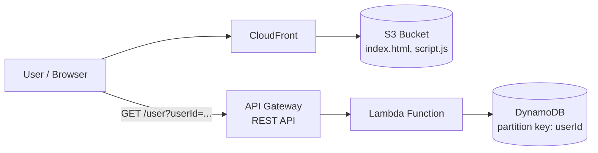

# three-tier-app-on-aws
Three-Tier Web Application on AWS (Serverless)  A serverless three-tier web application built on AWS: a static frontend served globally through CloudFront + S3, a Lambda + API Gateway logic tier, and a DynamoDB data tier.

# Three-Tier Web Application on AWS (Serverless)

A serverless three-tier web application built on AWS: a static frontend served globally through **CloudFront + S3**, a **Lambda + API Gateway** logic tier, and a **DynamoDB** data tier.

> Built as part of the [NextWork](https://nextwork.ai/projects/f10f5983-0a15-5628-94b2-1cc37b19cb8c) AWS project series.


---

## Architecture



| Tier | Service(s) | Responsibility |
|------|-----------|----------------|
| Presentation | S3, CloudFront | Hosts and globally distributes the static website |
| Logic | API Gateway, Lambda | Handles GET requests and looks up user data by `userId` |
| Data | DynamoDB | Stores user records; partition key is `userId` |

---

## What I Built

### 1. Presentation tier
- Created an S3 bucket to store the website files.
- Uploaded `index.html` (and later `script.js`).
- Put a CloudFront distribution in front of the bucket and accessed the site via the distribution domain name.

### 2. Logic tier
- Created a Lambda function that fetches a user record from DynamoDB based on `userId`.
- Returns the record on success, or an error message if the `userId` does not exist.
- Created an API Gateway REST API with a resource and a `GET` method, then deployed it.

### 3. Data tier
- Created a DynamoDB table with `userId` as the partition key (unique identifier per item).
- Added sample user data.

### 4. Integration
- Connected the tiers and tested the API Gateway invoke URL successfully.
- Wired the frontend (`script.js`) to the API Gateway URL.

---

## Troubleshooting Log

| Problem | Cause | Fix |
|---------|-------|-----|
| Frontend could not reach the API | `script.js` did not contain the API Gateway URL | Added the API URL to `script.js` and re-uploaded it to S3 |
| Access denied error after the update | CORS not configured | Enabled CORS in API Gateway with the CloudFront domain as `Access-Control-Allow-Origin` |
| Lambda response blocked by browser | Lambda response lacked the correct CORS header | Updated Lambda to return `Access-Control-Allow-Origin` restricted to the CloudFront distribution |
| Old files still served | CloudFront cache | Created a CloudFront **invalidation** for the updated paths |

---

## Key Learnings

- How to design and connect a three-tier architecture entirely with managed AWS services.
- Debugging CORS end to end (API Gateway configuration **and** Lambda response headers).
- Cache behavior in CloudFront and when to invalidate paths.
- Restricting `Access-Control-Allow-Origin` to a specific origin instead of using `*`.

**Time taken:** ~60 minutes

---

## Repository Structure

```
.
├── README.md
├── frontend/
│   ├── index.html
│   └── script.js
├── backend/
│   └── lambda_function.py      # Lambda handler (add your code here)
├── data/
│   └── sample-users.json       # Sample DynamoDB items
└── screenshots/
    ├── 01-cloudfront-site.png
    ├── 02-lambda-api-gateway.png
    ├── 03-dynamodb-table.png
    ├── 04-api-test.png
    ├── 05-console-errors.png
    ├── 06-cors-fix.png
    └── 07-final-result.png
```

---

## How to Reproduce

1. **S3:** Create a bucket and upload `frontend/index.html` and `frontend/script.js`.
2. **CloudFront:** Create a distribution with the bucket as the origin and note the distribution domain name.
3. **DynamoDB:** Create a table with partition key `userId` (String) and add items from `data/sample-users.json`.
4. **Lambda:** Create a function with `backend/lambda_function.py`, and give its execution role read access (`dynamodb:GetItem`) to the table.
5. **API Gateway:** Create a REST API, add a `GET` method integrated with the Lambda function, enable CORS with your CloudFront domain as the allowed origin, and deploy to a stage.
6. **Frontend config:** Set the API Gateway invoke URL in `script.js`, re-upload it to S3, and invalidate `/*` in CloudFront.
7. Open the CloudFront domain and verify the user data loads.

---


---

## Author

**Imayavarman Senthilkumar**
Email: i.varman.work@gmail.com
